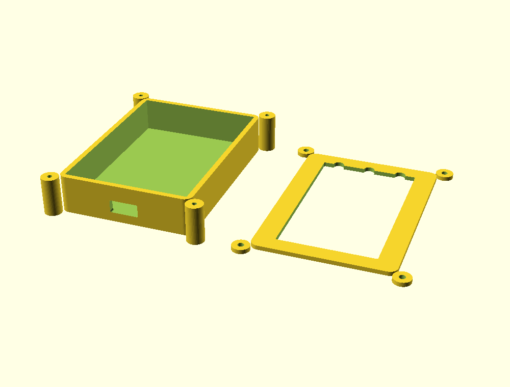

# Boîtier (étape P8)

Le boîtier est **paramétrique**, décrit en OpenSCAD dans
[`hardware/case/boitier.scad`](https://github.com/tlivernet/DIY-Arduino-variometer/blob/master/vario-esp32/hardware/case/boitier.scad).
Toute la géométrie découle d'une trentaine de paramètres regroupés en tête de
fichier : changer d'écran, de carte ou d'épaisseur de paroi ne demande jamais
de toucher au corps du modèle.



## Produire les pièces

```bash
make case          # exporte les deux STL et un aperçu PNG dans build/case/
```

Ou pièce par pièce :

```bash
openscad -o fond.stl  -D 'piece="fond"'  hardware/case/boitier.scad
openscad -o capot.stl -D 'piece="capot"' hardware/case/boitier.scad
```

`openscad` est optionnel dans l'environnement ; `make doctor` indique s'il est
présent, `make setup` explique comment l'installer.

## Architecture

Deux coquilles — un **fond** en cuvette et un **capot** plat — tenues par
quatre vis M2. L'empilement, du fond vers la façade :

```
fond → accu LiPo → PCB (composants vers le bas) → écran Sharp → capot
```

Le fond porte la fenêtre USB-C au ras du plan de la carte ; le capot porte la
fenêtre de l'écran, les trois trous de boutons et la grille sonore.

### Pourquoi des oreilles de vissage externes

C'est le choix le moins évident du modèle, et il est contraint, pas
esthétique. L'écran Sharp fait 42,8 mm de large et le PCB visé 46 mm : à eux
deux ils **remplissent toute la façade**. Il ne reste aucune marge intérieure
où loger une colonne de vis sans que celle-ci morde l'écran — le calcul le
confirme, la marge latérale tombe sous 2 mm alors qu'une colonne M2 correcte
en demande 5. Des colonnes internes aux quatre coins, l'implémentation la plus
courante, entreraient donc en collision avec le verre dans les deux axes.

Les vis sont donc déportées dans quatre **oreilles externes** le long des
grands côtés. Elles n'empiètent sur rien, se percent et se taraudent
proprement, et restent la solution standard des boîtiers imprimés quand la
carte occupe toute la surface.

## Paramètres à confronter au matériel réel

!!! warning "Rien n'a été monté"
    Les cotes viennent de la fiche technique du LS027B7DH01 et de la
    nomenclature de la variante B — **pas d'un montage**. Le PCB de la variante
    B n'existe pas encore (étape P7) : ses 46 × 66 mm sont un objectif de
    conception, pas une mesure. À vérifier avant d'imprimer une série :

    - le contour et l'épaisseur réels de l'écran, nappe FPC repliée comprise ;
    - l'encombrement de l'accu effectivement acheté (`accu_ep`) ;
    - la position de la prise USB-C sur le PCB une fois le tracé figé ;
    - l'entraxe réel des boutons et leur alignement avec la façade ;
    - le jeu d'ajustement `jeu`, à régler sur la première impression d'essai.

Imprimer d'abord **une seule coquille** pour valider les ajustements avant de
lancer la paire.

## Ce qui reste à faire

- **Encliquetage ou joint** : le modèle assemble par vis, sans étanchéité. Le
  baromètre exige de toute façon une prise d'air ; l'objectif est de protéger
  de la pluie et de la poussière, pas l'immersion.
- **Guides de boutons** : les poussoirs sont pour l'instant de simples
  perçages. Un capuchon souple ou un poussoir imprimé viendra ensuite.
- **Passage de la nappe** entre PCB et écran, à dessiner une fois la position
  du connecteur FPC connue (étape P7).
- **Support d'accu** pour l'empêcher de coulisser.
