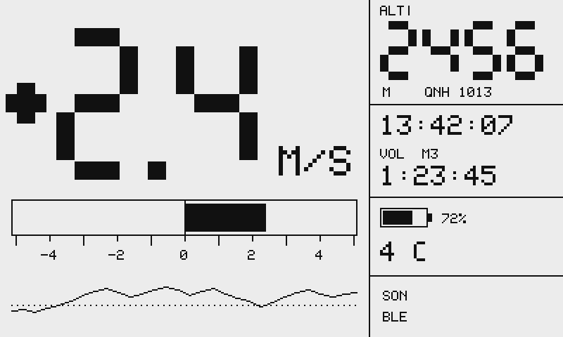
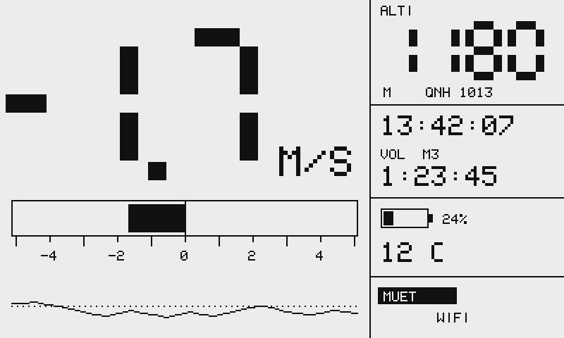
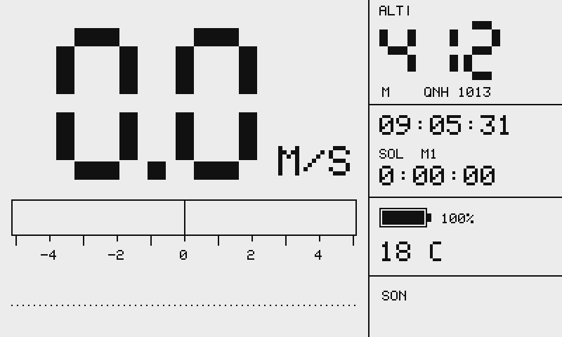
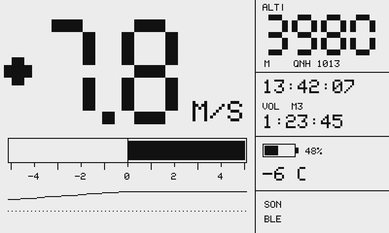
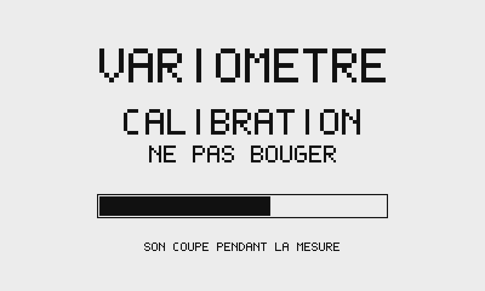
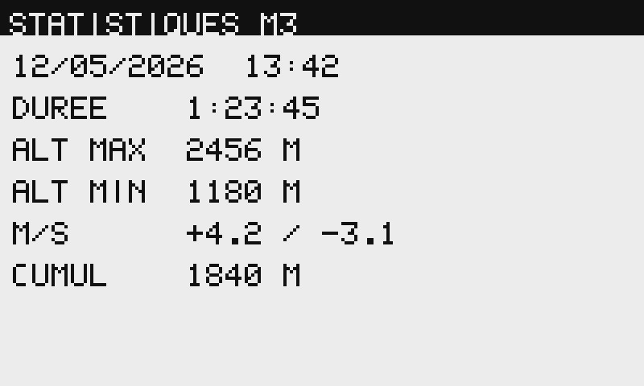
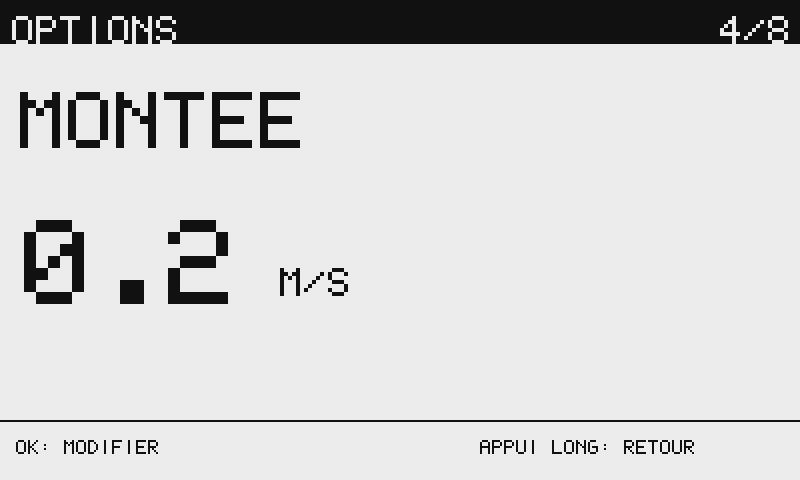
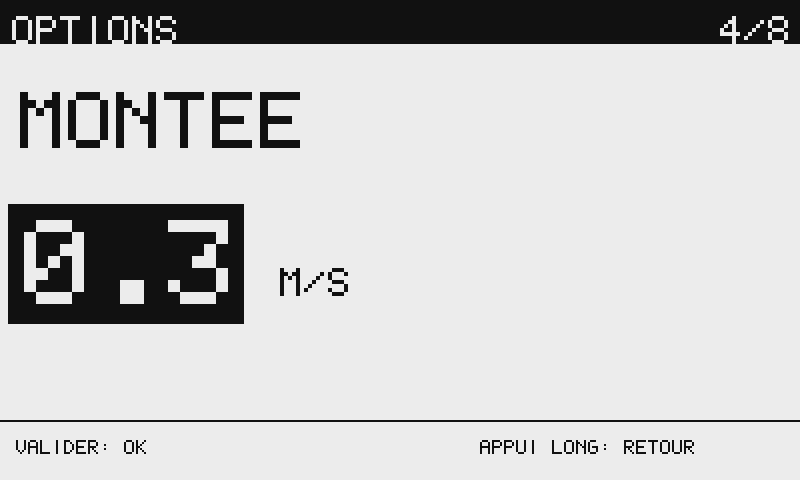

# Écrans

Toutes les images de cette page sont **produites par le vrai code d'affichage**, pas dessinées à la main. La couche de rendu étant du C++ pur, elle se compile et s'exécute sur un PC : le firmware peut donc rendre ses écrans dans des fichiers image avant que le moindre composant ne soit acheté.

```bash
make render   # → build/screens/*.png
```

Les rendus sont agrandis deux fois et affichés sur fond gris clair, pour imiter un écran réfléchissant qui ne renvoie jamais 100 % de la lumière.

## Écran principal

Contrainte de conception : l'appareil est lu **en vision périphérique, en pilotant une aile**. Ce qui compte n'est donc pas la quantité d'information mais la lisibilité à bout de bras en plein soleil. D'où un découpage en deux colonnes — la vitesse verticale occupe seule les deux tiers gauche, en chiffres de 108 pixels de haut, et tout le reste est relégué à droite.

### En montée

{ loading=lazy }

De gauche à droite et de haut en bas : vitesse verticale, unité, bande analogique remplie depuis le centre, courbe des 30 dernières secondes. À droite : altitude, QNH en cours, heure, état et chronomètre de vol avec l'emplacement d'enregistrement, batterie, température, indicateurs de son et de liaison.

En vol l'œil lit **la barre**, pas les chiffres ; ceux-ci ne servent qu'au sol.

### En descente, son coupé

{ loading=lazy }

Le son coupé est affiché en inverse vidéo : c'est l'état qu'il est le plus important de ne pas manquer sur un instrument qui se pilote à l'oreille.

### Au sol

{ loading=lazy }

C'est précisément l'état dans lequel l'ancien vario bipait dans le vide. Un test verrouille désormais le silence au repos.

### Fort taux de montée

{ loading=lazy }

La bande analogique sature à ±5 m/s, la courbe est écrêtée dans sa bande, et les températures négatives s'affichent correctement.

## Calibration au démarrage

{ loading=lazy }

Pendant deux secondes, l'appareil mesure l'orientation de la pesanteur et le biais du gyromètre à l'arrêt. Le son est coupé tant que le filtre n'est pas stabilisé, ce qui évite les sons parasites documentés sur les projets comparables, et l'écran le dit explicitement. Un petit motif à deux notes confirme ensuite que le son est armé.

## Statistiques d'un vol

{ loading=lazy }

Les huit derniers vols restent accessibles sous les libellés « M1 » à « M8 », comme en 2017 — mais ce ne sont plus des emplacements physiques dans une mémoire, seulement une vue sur les huit enregistrements les plus récents du journal.

## Menu

{ loading=lazy }

{ loading=lazy }

La valeur passe en inverse vidéo pendant l'édition, pour qu'on voie immédiatement qu'agir sur les boutons va la modifier. Le menu est engendré par la table de schéma de configuration : ajouter un réglage ne demande pas de toucher au code d'affichage.

## Deux choix techniques

### Des chiffres à sept segments

Une police bitmap de 108 pixels de haut coûterait des dizaines de kilo-octets de flash. Un rendu par rectangles ne coûte rien, s'adapte à n'importe quelle dimension, et donne l'allure d'un instrument de bord — ce qui est exactement l'effet recherché. Agrandir seize fois une police de 5×7, à l'inverse, donne un rendu de calculatrice de 1982.

Les petits libellés utilisent la police 5×7 reprise du projet de 2017, réduite à la plage ASCII imprimable : 95 glyphes et 475 octets, au lieu de 256 et 1280.

### Le suivi des lignes modifiées

Ce n'est pas une optimisation, c'est une nécessité. Une trame complète du Sharp LS027B7DH01 représente 12,5 ko à 1 MHz, soit **environ 100 ms** — bien trop lent pour rafraîchir à 10 Hz. En ne transmettant que les lignes réellement modifiées, la zone du gros chiffre tombe à ~46 ms et le champ horloge à ~8 ms.

Un test vérifie qu'écrire la valeur déjà présente ne salit *pas* la ligne : sans cela on retransmettrait tout l'écran à chaque image et le suivi ne servirait à rien.

## Tests de non-régression visuelle

Les écrans sont comparés à des images de référence versionnées. En cas d'écart, l'image obtenue est écrite dans `build/` pour être ouverte et comparée à l'œil, et l'intégration continue publie les rendus en artefacts : une régression de mise en page se constate d'un coup d'œil.

Un test va jusqu'à vérifier le défaut de formatage de 2017 **au niveau du pixel** : 1,96 m/s doit produire exactement les mêmes pixels que 2,00 m/s — l'ancien code affichait « 1.10 ». La comparaison ne porte que sur la zone des chiffres, la bande analogique différant légitimement entre les deux valeurs.

Rendre ces écrans a d'ailleurs révélé trois défauts qu'une maquette sur papier aurait manqués : l'étiquette de la courbe chevauchait l'échelle de la bande, la courbe tracée en points épais reliés par des barres verticales ressemblait à une chenille, et l'unité d'altitude se superposait à la ligne du QNH.
