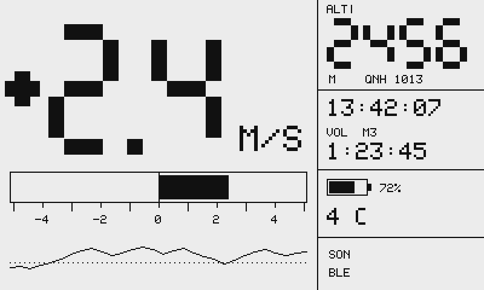

# Variomètre ESP32

Variomètre de parapente open source et open hardware, pour environ **42 €**, refonte complète du [projet Arduino de 2014-2017](https://github.com/tlivernet/DIY-Arduino-variometer).

!!! warning "État du projet"
    Le cœur logiciel est écrit et testé — **166 tests** — mais **rien n'a encore volé**. Les pilotes matériel, le circuit imprimé et le boîtier sont à venir. Voir la [feuille de route](feuille-de-route.md).

{ loading=lazy }

## En bref

| | |
|---|---|
| **Calculateur** | ESP32-S3 — USB natif, BLE 5, deux cœurs |
| **Baromètre** | MS5611, résolution 10 cm |
| **Centrale inertielle** | 6 axes, pour un vario compensé en accélération |
| **Écran** | Sharp Memory LCD 2,7", 400×240, lisible en plein soleil |
| **Son** | piezo large bande, attaque push-pull tamponnée en 5 V |
| **Commande** | trois boutons étanches, utilisables avec des gants |
| **Liaison** | BLE vers XCTrack et XCSoar (trames LK8EX1) |
| **Autonomie** | ~27 h sur une batterie 1S de 1500 mAh |
| **Budget** | ≈ 42 €, contre 250 à 400 € pour un vario du commerce |

## Ce qui change par rapport à la version de 2017

**Le vario réagit avant que l'altitude ne bouge.** La pression barométrique est fusionnée avec l'accélération verticale par un filtre de Kalman. Comme l'accélération est une *entrée de commande* et non une mesure, la vitesse verticale répond par intégration directe, sans attendre. La latence passe de ~0,8 s à ~0,15 s, **et** le bruit affiché de 0,3-0,4 m/s à moins de 0,1 m/s — les deux en même temps, ce que le filtre purement barométrique ne pouvait pas faire.

**Il se tait quand il ne se passe rien.** L'ancien vario portait plus de bruit que son propre seuil de déclenchement, donc il bipait posé sur une table. Le plancher de bruit abaissé rend enfin utilisable un seuil de montée à 0,2 m/s, et la machine à états du bipeur a désormais une hystérésis.

**Il se configure au navigateur.** Un portail Wi-Fi remplace le réglage à la molette sur un écran de 84×48.

**Il sert de capteur au téléphone.** Le BLE émet des trames LK8EX1 : XCTrack ou XCSoar l'utilisent directement.

**Il n'oublie plus les vols.** Journal en ajout seul avec somme de contrôle et reprise après coupure. Dans l'ancienne version, une batterie vide à 3000 m coûtait le vol entier, et l'enregistrement s'arrêtait définitivement au bout de huit vols.

**Il se compile.** Une commande, et une intégration continue qui vérifie tout à chaque modification. L'ancien code ne compilait plus que sur un IDE Arduino de 2015.

## Antériorité

Ce projet n'est pas le premier à faire un vario sur ESP32, et ces travaux ont directement nourri sa conception :

- **[GNUVario-E](https://prunkdump.github.io/GNUVario-TTGO-T5-website/)** — projet français open source et open hardware très proche : ESP32, écran e-paper, MS5611 + MPU9250, boîtier imprimé en 3D, documentation en français et en anglais. À lire avant de se lancer.
- **[har-in-air/ESP8266_MPU9250_MS5611_VARIO](https://github.com/har-in-air/ESP8266_MPU9250_MS5611_VARIO)** — fusion Kalman « zéro lag » et portail Wi-Fi de configuration. C'est de là que viennent deux choix : le MS5611 plutôt que le BMP280, dont les pics de bruit sont rédhibitoires en vario, et le piezo large bande plutôt qu'un buzzer à fréquence fixe.
- [ESP32-Realtime-Vario](https://github.com/ghf20/ESP32-Realtime-Vario), [sensorio](https://github.com/zmolnar/sensorio), [VhARIO-ESPC3](https://github.com/har-in-air/VhARIO-ESPC3).

## Licence

À définir avant publication. Le code de 2017 n'en portait aucune.
