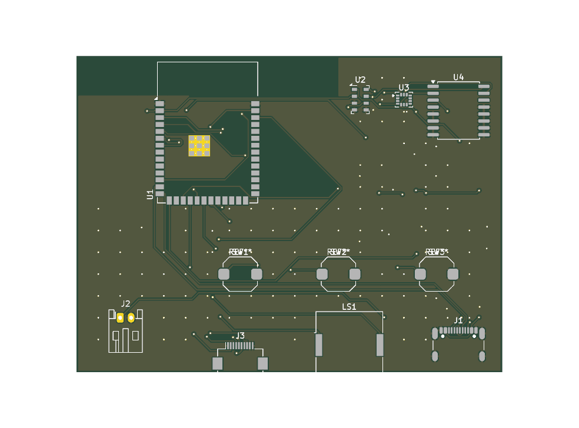

# Circuit imprimé (étape P7)

Le schéma KiCad de la **variante B** (tout intégré sur un circuit imprimé, par
opposition à la variante A à modules) vit dans
[`hardware/pcb/`](https://github.com/tlivernet/DIY-Arduino-variometer/tree/master/vario-esp32/hardware/pcb).

!!! info "Périmètre de cette étape"
    P7 livre le **schéma** validé électriquement (ERC propre) et sa netlist.
    Le **tracé du circuit** (placement, routage, plans de masse, sorties de
    fabrication) est l'étape suivante et n'est pas encore fait.

## Un schéma engendré, pas dessiné

Comme la nomenclature et les écrans, le schéma est **engendré** par un script,
[`generate_schematic.py`](https://github.com/tlivernet/DIY-Arduino-variometer/blob/master/vario-esp32/hardware/pcb/generate_schematic.py).
Sa source de vérité est une **table de connexions** — un mapping lisible
`composant → (broche → net)` — et non des coordonnées de fils. La connectivité
passe par des étiquettes globales homonymes : deux broches portant le même nom
de net sont reliées.

Le bénéfice est le même que partout ailleurs dans ce dépôt : le brochage
s'audite ligne par ligne dans le script, et le fichier `.kicad_sch` se
régénère à l'identique.

```bash
make schematic     # engendre hardware/pcb/vario.kicad_sch
make erc           # contrôle électrique (ERC), doit être propre
```

La contrepartie : le placement est sur une grille large, **le schéma n'est pas
mis en page pour la lecture**. Le peaufinage graphique (regrouper par bloc,
tracer les vrais fils) se fait dans l'éditeur KiCad avant le routage — il ne
change pas la connectivité, seulement sa présentation.

## État de vérification

| Élément | État |
|---|---|
| Chargement par KiCad 9 | **vérifié** (`kicad-cli`) |
| ERC (règles électriques) | **propre** — 0 erreur, 0 avertissement de conception |
| Export de netlist | **vérifié** |
| Brochages contre les bibliothèques KiCad système | **vérifié** |
| Brochage du TPS61023 | **vérifié contre le datasheet** TI SLVSF14B |
| Empreintes existent dans les bibliothèques système | **vérifié** |
| Tracé du PCB, plans de masse, Gerbers | **non fait** |
| Fonctionnement sur carte réelle | **jamais testé** |

Les seuls avertissements que l'ERC émet encore sont « la bibliothèque n'est pas
dans la configuration » et « empreinte introuvable dans la bibliothèque » : ils
viennent de l'exécution *headless* de `kicad-cli`, qui n'a pas les tables de
bibliothèques de l'utilisateur. Ils disparaissent à l'ouverture du projet dans
KiCad. `make erc` les filtre et n'échoue que sur les autres catégories.

## Choix de conception

### Baromètre en I2C

Le schéma câble le MS5611 en **I2C**, sur le bus partagé avec la centrale
inertielle et l'horloge. C'est le bus que pilote le firmware actuel, déjà
écrit et testé. La documentation matériel évoque un passage du baromètre en SPI
pour la variante B (pour éviter tout étirement d'horloge ou blocage de bus) :
c'est une évolution **future**, non implémentée côté logiciel, et la câbler
maintenant produirait un circuit que le firmware ne saurait pas piloter.

Adresses sur le bus : baromètre `0x76` (CSB à la masse), centrale `0x6A`
(SDO/SA0 à la masse), horloge `0x68`. Les broches de sélection d'adresse des
deux capteurs sont tirées à la masse par une résistance de 0 Ω (`R15`, `R16`)
plutôt qu'en direct : l'adresse reste modifiable au montage.

### Deux rails, deux étages

Un élévateur `TPS61023` porte l'accu à **5 V** (`U6`), suivi d'un régulateur
linéaire `TLV75733` à **3,3 V** (`U7`). Le rail 5 V est nécessaire à l'écran
Sharp et au tampon audio ; le 3,3 V alimente le calculateur et les capteurs.
Le diviseur de contre-réaction de l'élévateur est `R10 = 909 kΩ` / `R11 =
100 kΩ`, ce qui donne 5,0 V pour une tension de référence de 0,5 V.

### Le tampon audio est le décaleur de niveau

L'ESP32 (sorties 3,3 V) attaque deux tampons `74HCT1G34` alimentés en **5 V**
(`U8`, `U9`), dont les sorties commandent le piezo. La famille **HCT** a des
seuils TTL (seuil haut ~2 V), donc une sortie 3,3 V les commande de façon
fiable. C'est délibérément ce tampon qui fait office de décaleur de niveau :
l'analyse relève un « croisement de domaines 5 V / 3,3 V sans décaleur » sur
les nets audio, ce qui est exactement le montage voulu.

Deux tampons simples remplacent le double `74HCT2G34` de la nomenclature : le
symbole double est multi-unités, ce que le générateur ne gère pas, et deux
portes simples sont électriquement équivalentes pour le push-pull. La
nomenclature a été mise à jour en conséquence (deux `74HCT1G34`).

### Protection de l'entrée USB

Une diode **TVS** (`D1`) protège le rail `VBUS` contre les décharges
électrostatiques à la prise USB-C — ajout issu de l'analyse du schéma.

## Pièce sans symbole système : le TPS61023

Le `TPS61023` n'a pas de symbole dans les bibliothèques KiCad 9. Il est défini
dans la bibliothèque projet
[`vario-symbols.kicad_sym`](https://github.com/tlivernet/DIY-Arduino-variometer/blob/master/vario-esp32/hardware/pcb/vario-symbols.kicad_sym),
avec le brochage du package **SOT-563 (DRL)** vérifié contre le datasheet :

| Broche | Nom |
|---|---|
| 1 | FB |
| 2 | EN |
| 3 | VIN |
| 4 | GND |
| 5 | SW |
| 6 | VOUT |

La nomenclature indiquait à tort un boîtier SOT-23-6 ; elle a été corrigée en
SOT-563, et la référence figée en `TPS61023DRLR`.

## Empreintes à créer sur mesure

Deux empreintes utilisées sont des approchantes de la bibliothèque système, à
remplacer par le composant exact avant le routage :

- **Connecteur écran `J3`** : la nomenclature spécifie un Hirose `FH34SRJ`,
  absent des bibliothèques. Le schéma utilise provisoirement un `FH12-10S`
  (10 voies, pas 0,5 mm). **Vérifier le sens de contact** de la nappe réelle du
  LS027B7DH01 — c'est le genre d'erreur qui ne se voit qu'au montage.
- Le brochage de la nappe écran dans la table de connexions suit une hypothèse
  documentée ; à confirmer contre la fiche du panneau.

## Analyser le schéma

Le dépôt inclut le greffon `kicad-happy`. Pour une revue :

```bash
python3 <chemin-du-greffon>/scripts/analyze_schematic.py \
    hardware/pcb/vario.kicad_sch --text
```

Il détecte les rails, les bus, les sous-circuits (régulateurs, diviseurs,
filtres), vérifie la couverture des références fabricant et signale les
croisements de domaines de tension.

## Le circuit imprimé



Le PCB est lui aussi **engendré**, en trois étages :

```bash
make pcb                       # place les empreintes (generate_pcb.py)
make route JAR=freerouting.jar # route (freerouting), voir ci-dessous
make fab                       # Gerbers + perçage + position + BOM JLCPCB
```

- **`generate_pcb.py`** lit la netlist du schéma, charge les empreintes, les
  place par blocs fonctionnels sur une carte **78 × 58 mm** (deux couches),
  ajoute le contour, deux plans de masse et une grille de vias de couture.
  L'ESP32 est au bord haut-gauche pour que son keep-out d'antenne déborde hors
  carte. Les découplages et petits passifs sont au **dos**, la face avant étant
  occupée par l'écran.
- **`route_pcb.py`** exporte en Specctra DSN, lance l'autorouteur
  [freerouting](https://github.com/freerouting/freerouting) en mode headless,
  réimporte la session et re-remplit les plans de masse. `freerouting.jar`
  (55 Mo) n'est pas versionné : le télécharger et le passer via `JAR=`.
- **`export_fab.py`** produit les fichiers JLCPCB dans `build/fab/` et une
  archive `build/vario-gerbers.zip`.

!!! danger "Un routage automatique, pas une carte validée"
    L'autorouteur tire **~85 nets sur 86** et le DRC passe sur les règles
    JLCPCB, mais **rien de tout cela ne prouve un bon PCB**. La qualité fine —
    continuité du plan de masse sous l'ESP32, zone d'antenne, longueur et
    couplage de la paire USB `D+/D-` — ne se vérifie pas par script. **Une
    relecture humaine dans KiCad reste indispensable avant de commander**, de
    préférence par quelqu'un ayant déjà routé une carte. Le PCB n'a jamais été
    fabriqué ni testé.

### Finition à faire dans KiCad

Le flux automatique laisse une **douzaine de connexions** à terminer à la main
dans l'éditeur — un travail de quelques minutes, mais **interactif par nature** :
tirer une piste ou poser un via demande de voir les obstacles à l'écran. Le
faire par script s'est révélé contre-productif (chaque via ou piste posé à
l'aveugle créait des collisions ailleurs), il n'y a donc **pas** de script de
finition : c'est assumé comme l'étape où l'humain reprend la main.

Ce qui reste, tout localisé, aucun défaut de conception :

- **plan de masse fragmenté** : le plan `GND` est découpé en îlots par les
  pistes de signal. Dans KiCad : *Outils → Nettoyer les pistes*, puis
  *Éditer → Remplir toutes les zones* (`B`) recoud la plupart des îlots ;
  ajouter un via `GND` dans toute région encore isolée ;
- **quelques pads `GND` enclavés** (buffers, écran, IMU) : un via `GND` posé
  sur le pad le descend jusqu'au plan de l'autre couche ;
- **une à deux liaisons de signal** courtes non routées (selon le tirage de
  l'autorouteur, p. ex. `IMU_INT1` entre `U1` et `U3`, ou `VBUS`) : les tracer
  à la main en contournant les pistes existantes ;
- vérifier la **zone d'antenne** de l'ESP32 (aucun cuivre sous l'antenne) ;
- confronter le **contour de carte** au boîtier (étape P8), la carte ayant
  grandi à 78 × 58 mm pour loger l'écran, les boutons et le keep-out.

Le nombre et la nature exacts de ces connexions varient légèrement d'un
routage à l'autre (l'autorouteur est stochastique) ; `kicad-cli pcb drc
vario.kicad_pcb` en donne la liste courante.

## Fabrication et assemblage JLCPCB

`make fab` engendre :

| Fichier | Rôle |
|---|---|
| `build/vario-gerbers.zip` | Gerbers 2 couches + perçage, à téléverser |
| `build/fab/vario-bom-jlcpcb.csv` | nomenclature avec références LCSC |
| `build/fab/vario-cpl-jlcpcb.csv` | position des composants (assemblage) |

**Disponibilité vérifiée** (2026-07-26, API jlcsearch) : tous les composants
actifs ont une référence LCSC en stock. Ils sont *extended* (frais de pose
~3 $/référence) ; les passifs 0603 sont *basic* (sans frais).

**JLCPCB assemble 49 composants sur 50** — y compris le baromètre (QFN) et la
centrale inertielle (LGA), infaisables au fer, ainsi que les boutons, l'USB, le
connecteur d'écran, le connecteur d'accu et le support de pile RTC.

**Un seul composant se pose à la main** : le disque **piézo `LS1`** (20 mm). Ce
n'est pas un manque mais un choix — un disque piézo se monte **déporté**, collé
au boîtier et relié par deux fils, où il sonne mieux qu'à plat sur la carte.

À acheter séparément de toute façon (jamais dans une nomenclature d'assemblage) :
l'**accu LiPo 1S** protégé, une **pile CR1220** (~0,50 €, à glisser dans le
support `BAT2`), et l'**écran** LS027B7DH01 lui-même.

!!! warning "À confirmer avant commande"
    - **Connecteur d'écran `J3`** : référence exacte `C324723`
      (FH34SRJ-10S-0.5SH) mais empreinte **FH12** approchante — à valider contre
      le connecteur réel et le **sens de contact** de la nappe.
    - **Rotations** des composants sur le fichier de position : la convention de
      JLCPCB diffère de KiCad pour certains boîtiers (voir la table du greffon
      `jlcpcb`).
    - **Support de pile `BAT2`** : empreinte CR1225 approchante du support
      CR1220 réel — vérifier l'empreinte. La pile CR1220 n'est **pas**
      rechargeable, ce qui est sûr ici : la broche VBAT de la DS3231 est une
      entrée de sauvegarde, jamais une sortie de charge.
